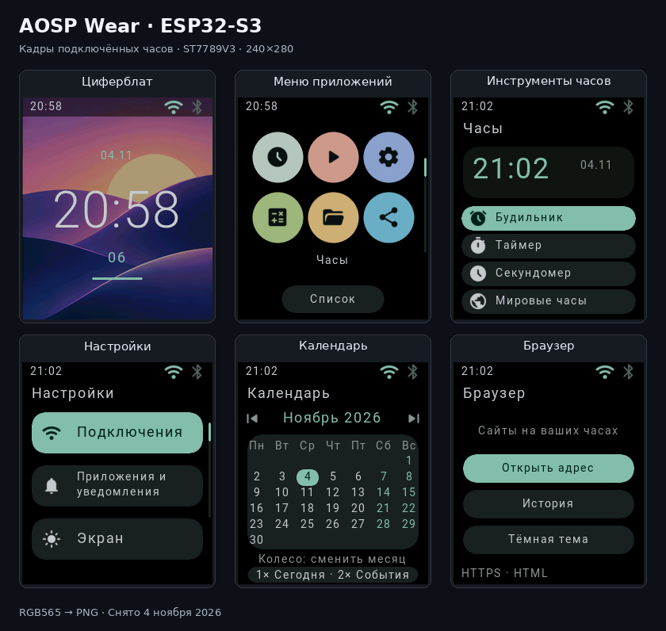
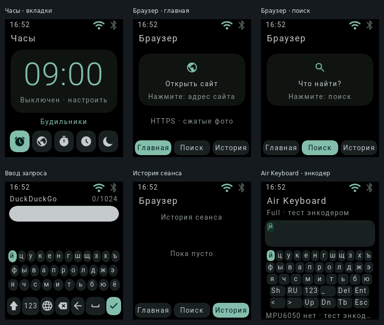
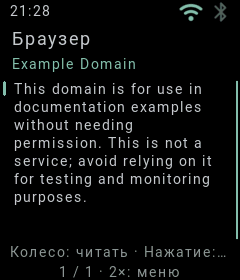
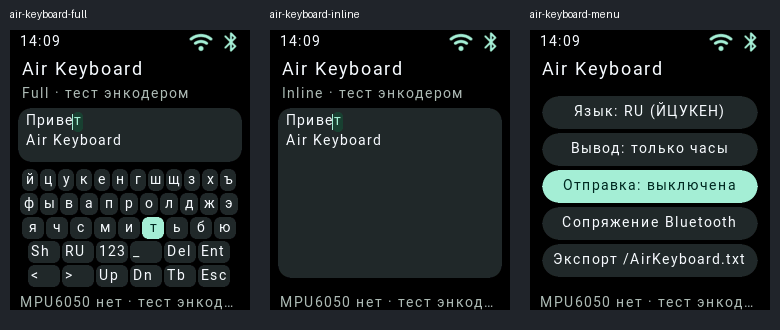

Google Gateway: [запуск на телефоне через Termux и на ПК, приватная OAuth-настройка](GoogleAuthGateway/README.md).

Сервисный запуск: [10 секунд для перезапуска, выбор Fastboot/Recovery колёсиком](Bootloader/DELIVERY.md).

Актуальное разделение проекта: [загрузчик → прошивка → приложения](ARCHITECTURE.md).
Код приложений находится в App, HAL и службы — в Firmware; Bootloader содержит
загрузочную библиотеку и инструменты. Это собственная прошивка ESP32-S3, без Linux/ART/APK.

# AOSP Wear for ESP32-S3 — current release 17.2.1

**Platform identity:** Android 17 QPR1 / API 37  
**Project release:** 17.2.1  
**Target:** Waveshare ESP32-S3-Zero-N4R2 + ST7789V3 240×280

17.2.1 provides an encoder-first Wear interface with on-watch weather, native
utilities and ordinary wireless ADB. Browser remote control has been removed.

## Превью интерфейса



Снимки буфера экрана **физического ESP32-S3**, снятые 4 ноября 2026 года.
Исходное разрешение каждого кадра — **240×280**.
[Отдельные PNG и способ съёмки](doc/preview/README.md).

### Браузер и клавиатура на часах · 5 ноября



Сборка установлена на ESP32-S3. Выше — снимки реального RGB565-буфера 240×280:
вкладки часов и браузера, ввод запроса, история и Air Keyboard.
[Проверка на устройстве и исходные кадры](doc/preview/device-20261105/README.md).
[Программное превью результатов поиска и настроек сна](doc/preview/browser-dock/README.md)
использует синтетические данные.

### Браузер без Google Gateway · 5 ноября



HTTPS, DNS, разбор HTML и уменьшение JPEG/PNG теперь выполняют сами часы.
Нужны Wi-Fi и синхронизированное время. Есть ссылки, история и прямой поиск
DuckDuckGo; поисковик может потребовать CAPTCHA и отказать часам.
Это режим чтения без JavaScript, полной CSS-вёрстки и входа в Google.
[Возможности и ограничения](App/system/app/Browser/README.md),
[проверка на устройстве](doc/preview/native-browser-20261105/README.md).
В режиме `./flash pc` ПК всё ещё подаёт системный образ через USB.

### Air Keyboard — программный стенд



Кадры выше построены штатным RGB565-рендерером из кода нового приложения.
Сборка установлена и проверена на часах 5 ноября 2026 года. Сейчас доступен тестовый
ввод энкодером; MPU6050 ещё не установлен, управление движением руки не реализовано.
[Состояние реализации и инструкция](doc/air-keyboard/README.md).

```bash
./flash pc  # Запуск с образом на ПК, без карты памяти
./flash sd  # Запуск с microSD
```

The watch does not run an HTTP control server. ADB remains available on port
5555 when enabled; weather uses outgoing public API requests.

## Комплектующие и подключение платы

Текущая сборка рассчитана на **Waveshare ESP32-S3-Zero-N4R2**, экран
**ST7789V3 240×280**, энкодер с кнопкой и microSD. Номера ниже — **GPIO**,
а не порядковые номера контактов по краю платы. Земля периферии общая с GND
платы. Сигнальные линии ESP32-S3 работают с логикой 3,3 В.

### Материалы

| Компонент | Для чего / что проверить |
|---|---|
| ESP32-S3-Zero-N4R2 | Именно вариант с 4 МиБ Flash и 2 МиБ PSRAM |
| ST7789V3 240×280 | SPI-модуль с совместимыми питанием и входом подсветки BL/BLK |
| Энкодер A/B с кнопкой | Колёсико и нажатие; общий контакт — GND |
| microSD и 3,3-В SPI-модуль | Для автономного режима SD; в PC-режиме карта необязательна |
| MPU6050, например модуль GY-521 | Акселерометр + гироскоп; ниже зарезервирована отдельная I²C-шина |
| Одноэлементная АКБ Li-ion/LiPo 1S | Номинал 3,7 В, заряд до 4,2 В; ёмкость и допустимый ток зарядки — по паспорту АКБ |
| Модуль TPS61023 | Повышение напряжения АКБ; вариант схемы ниже предполагает выход **5,0 В** |
| Модуль TP4056 | Зарядка 1S; конкретную плату нужно проверить на наличие защиты аккумулятора |
| Защита 1S | Нужна защита от переразряда/КЗ: встроенная в АКБ либо отдельная; часто присутствует на TP4056-платах с DW01A/8205A |
| Выключатель, провода, разъёмы, изоляция | Разъём АКБ с проверенной полярностью, короткие силовые провода; защита соединений от замыкания |
| USB-кабель для данных, паяльные материалы, мультиметр | Прошивка/отладка и проверка питания перед подключением платы |

TPS61023 — повышающий преобразователь, TP4056 — зарядное устройство. Они
не измеряют достоверный процент заряда для интерфейса часов. В прошивке пока
нет измерителя АКБ и драйвера MPU6050; жесты и шагомер не включены.

### Дисплей, microSD и колёсико: действующая распиновка

| Контакт модуля | ESP32-S3-Zero | Примечание |
|---|---|---|
| ST7789 SCK / SCL | GPIO1 | SPI3, это **не** I²C SCL |
| ST7789 MOSI / SDA / DIN | GPIO2 | SPI3, это **не** I²C SDA |
| ST7789 RST / RES | GPIO3 | Сброс дисплея |
| ST7789 DC | GPIO4 | Команда/данные |
| ST7789 CS | GPIO5 | Выбор дисплея |
| ST7789 BL / BLK | GPIO6 | Управляющий вход подсветки модуля; голый светодиод подсветки требует драйвера, не питания от GPIO |
| ST7789 GND | GND | Общая земля |
| ST7789 VCC | 3V3 для совместимого 3,3-В модуля | Ориентироваться на схему конкретного модуля |
| microSD DO / MISO | GPIO7 | SPI2 |
| microSD CLK / SCK | GPIO8 | SPI2 |
| microSD DI / MOSI | GPIO9 | SPI2 |
| microSD CS | GPIO10 | SPI2 |
| microSD VCC / GND | 3V3 / GND | Для используемого 3,3-В мини-модуля; 5 В на него не подавать |
| Энкодер A / CLK | GPIO11 | Вход с подтяжкой |
| Энкодер B / DT | GPIO12 | Вход с подтяжкой |
| Энкодер COM / GND | GND | Если на модуле есть VCC — питание логики только 3,3 В |
| Кнопка SW | GPIO13 и GND | Замыкание на землю при нажатии |
| Native USB D− / D+ | GPIO19 / GPIO20 | Уже соединены с USB-C платы; сюда периферию не подключать |
| Встроенный RGB LED | GPIO21 | Занят платой |

Рабочие SPI-частоты и назначение выводов заданы в
[конфигурации](Firmware/src/config.rs) и
[инициализации платы](Firmware/src/init.rs). SD-карта содержит сырой образ
GPT проекта; форматирование в FAT32 для этой сборки не требуется.

### MPU6050: запланированное подключение

Эти GPIO свободны от экрана, SD и энкодера. Это **схема для будущего драйвера**:
данная прошивка пока не создаёт I²C-шину на GPIO14/15 и не читает MPU6050.

| MPU6050 / GY-521 | Подключить к | Назначение |
|---|---|---|
| VCC | 3V3 платы | Проверить допустимое питание именно вашего модуля |
| GND | GND платы | Общая земля |
| SDA | GPIO14 | Данные I²C |
| SCL | GPIO15 | Тактирование I²C |
| INT | GPIO16 | Резерв под прерывание; для первого опроса необязателен |
| AD0 | GND | Адрес I²C `0x68`; при AD0=3V3 адрес `0x69` |
| XDA / XCL | Не подключать | Вспомогательная шина датчика, здесь не используется |

SDA/SCL должны иметь подтяжки **к 3,3 В**, обычно они уже установлены на
GY-521. Если их нет — предусмотреть внешние подтяжки для выбранной скорости
и длины проводов. Сам кристалл MPU6050 рассчитан на VDD 2,375–3,46 В; наличие
стабилизатора на модуле не означает, что сигналы ESP32 допускают 5 В.
См. [спецификацию TDK/InvenSense](https://invensense.tdk.com/wp-content/uploads/2015/02/MPU-6000-Datasheet.pdf).

### АКБ, TP4056 и TPS61023

Ниже вариант для **TPS61023 с выходом 5,0 В** и **TP4056-модуля с отдельными
B+/B− и защищёнными OUT+/OUT−**. Для модуля без защиты нужны защищённая АКБ
или отдельная плата защиты. Маркировки контактов конкретного модуля имеют
приоритет: IN+/IN−, VIN/GND и OUT+/OUT− могут называться по-разному.

```text
USB 5 В для зарядки ── TP4056 IN+
USB GND            ── TP4056 IN−
АКБ +              ── TP4056 B+
АКБ −              ── TP4056 B−

TP4056 OUT+ ── TPS61023 VIN+
TP4056 OUT− ── TPS61023 VIN− / GND
TPS61023 VOUT+ (проверенные 5,0 В) ── выключатель ── ESP32-S3-Zero 5V
TPS61023 VOUT− / GND             ──────────────── ESP32-S3-Zero GND
ESP32-S3-Zero 3V3 ── питание совместимых модулей экрана, SD и MPU6050
```

**USB платы и повышайку не включать параллельно без развязки.** По схеме
Waveshare контакт 5V связан с USB VBUS. Для простого стендового варианта перед
подключением USB-C платы разомкнуть связь **TPS61023 VOUT+ → 5V платы**:
тогда плата питается от USB. Один диод только в ветви повышайки не решает
возможную обратную подачу питания в USB компьютера. Для автоматической смены
USB/АКБ нужен отдельный power mux / корректная развязка обеих ветвей.
См. [схему ESP32-S3-Zero](https://files.waveshare.com/wiki/ESP32-S3-Zero/ESP32-S3-Zero-Sch.pdf).

Землю системы брать с **защищённого OUT−**, а не соединять напрямую с B−
в обход защитных ключей. АКБ 4,2 В и выход повышайки 5 В не подключать к 3V3
или GPIO. До подключения ESP32 проверить мультиметром полярность и напряжение
VOUT модуля; TPS61023 выпускается на платах с разными установками выхода.

TP4056 не содержит отдельного выхода SYS с управлением power-path. В простом
варианте заряжать АКБ при отключённой нагрузке: нагрузка на аккумуляторе может
мешать определению окончания зарядки. Для работы часов во время зарядки нужна
схема load sharing / power-path. Ток зарядки выбирается по паспорту АКБ и
нагреву модуля; заводские 1 А могут быть недопустимы для маленькой АКБ часов.
Не копировать RPROG вслепую: сначала определить допустимый ток своей батареи.
См. [даташит TP4056 производителя UMW](https://www.umw-ic.com/static/pdf/f5956b63399d772bf88e62b3e89eb312.pdf).

TPS61023 сам по себе не заменяет защиту Li-ion от глубокого разряда.
Сведения о диапазонах напряжений, EN и токах — в
[даташите TI](https://www.ti.com/lit/ds/symlink/tps61023.pdf). USB-тестирование,
автономная работа и зарядка — разные режимы питания; их автоматическое
совмещение нужно проектировать после выбора конкретных модулей и АКБ.

## Logs and background work

The main loop sleeps through the RTOS between input polls. Static Material
scenes reuse the Rhai result while native clocks, PIN locking and timer alerts
continue ticking. Background screen checks normally run once per second,
and exact deadlines for an immediate dim step ten seconds before screen-off.
Viewer state is sent only after a viewer subscribes with SYNC/PING; identical
state is not repeatedly printed while the watch lies idle.

## Crown gestures and text input

Hold the crown button and rotate forward/back for right/left swipes. Releasing
after a gesture does not also click a row or trigger a long-press action.
The configured reverse direction applies to these gestures. Ordinary rotation
and button holds remain unchanged when no chord is used.

Device name and Wi-Fi password use one phone-style keyboard with QWERTY/ЙЦУКЕН
rows, RU/EN, Shift, digits, symbols, Space, Delete, Done and Cancel. Rotate to
focus, press to activate; the focus changes color without resizing keys.
Device names are limited to 32 UTF-8 bytes, passwords to 64. Voice input is a
future companion feature; a microphone button is not currently implemented.

Browser/Telegram architecture and current limitations are described in
[DELIVERY.md](Bootloader/DELIVERY.md); neither client is implemented yet.

## Ordinary Android ADB over Wi-Fi

The firmware has a limited native ADB TCP service. The system `adb` client
connects to it directly; the local `./adb` helper is optional.

```sh
adb connect 10.214.249.238:5555   # use the current address shown by the watch
adb logcat
adb logcat -d -v threadtime
adb logcat '*:W'
adb shell getprop ro.product.name
adb shell settings put global device_name 'AOSP Denis'
```

`logcat` streams the firmware's bounded 32-record RAM log ring with ACK pacing.
It supports `-d`, `-c`, `-t N`, `-T N`, `-s`, `-v brief|raw|time|threadtime`
and `Tag:I` filters. Logs are volatile; ROM/vendor panic output may only be
visible on serial. PID/TID are zero; timestamps before RTC sync use boot time.
This is an embedded service subset, not a Linux shell or Android userspace.

Product identity is centralized in `Firmware/src/device_info.rs`, exposed
by the main module. the current product names and manufacturer follow that file;
the editable friendly name is separate and saved on the card. The crown editor
is in **Настройки → Система → Имя устройства**. BLE advertisements refresh
when advertising restarts; a connected peer may cache its previous name.

## Приложения, проводник и текстовый редактор

В меню **18 приложений**. Системные сведения и диагностика находятся в
настройках, мировое время — в «Часах». Помимо прежних утилит добавлены
«Текстовый редактор», «Задачи», «Расходы», «Фокус» и «Телефон».

«Файлы» теперь позволяет создавать папки и документы, открывать UTF-8-текст,
переименовывать, копировать и перемещать файлы/папки. Выберите элемент, нажмите
колёсико и выберите действие. После «Копировать» или «Вырезать» перейдите в
папку назначения и нажмите «Вставить». Удаление требует подтверждения; папку
сначала нужно освободить от содержимого.

Хранилище документов — небольшой собственный формат в зарезервированном
диапазоне userdata, **не FAT/ext4** и не доступ к произвольным системным
разделам. Лимиты: 32 записи вместе с папками, 3072 байта на файл, 80 UTF-8
байт на полный путь. Записи «Задач» и «Расходов» используют общие файлы
/tasks.txt и /expenses.txt; не переименовывайте их, если хотите сохранить
доступ к спискам из этих приложений. Системные обои остаются доступны через
настройки и read-only /sdcard/Wallpapers.

Редактор работает построчно: выберите строку → нажмите → измените текст общей
RU/EN-клавиатурой → подтвердите. В конце списка есть «Добавить строку» и
«Сохранить». На второй странице символов доступна клавиша NL для переноса.
Выход с изменениями предлагает сохранить/отменить их. Новая копия файла
проверяется до переключения каталога; при конфликте с внешним изменением
нужно открыть файл заново. Файлы сохраняются на карте или в PC-образе.

Обычный ADB поддерживает обмен документами, когда часы разблокированы:

```sh
adb push note.txt /sdcard/Documents/note.txt
adb pull /sdcard/Documents/note.txt ./note-copy.txt
adb pull /sdcard/Wallpapers/1.png ./watch-wallpaper.png
```

SYNC поддерживает STAT/LIST/SEND/RECV для документов и прежний интерфейс
обоев. Создавайте папки на часах; Linux shell/mkdir и полный Android shell
не предоставляются. Блокировка PIN прекращает внешний доступ к документам.

«Задачи» хранит до 24 пунктов с отметками выполнения; готовые можно очистить.
«Расходы» хранит до 24 сумм с описаниями и выводит итог без ошибок двоичного
округления копеек: ввод, например, «12.50 продукты». «Фокус» — рабочие сессии
15/25/45 минут и пятиминутный перерыв с паузой; выход из приложения не
останавливает текущий этап. «Телефон» описан ниже.

Калькулятор поддерживает приоритет операций, скобки, смену знака выражения,
проценты, квадрат, корень и повторное «=». Циферблатов пять: цифровой,
аналоговый с минутными делениями, компликации, минимализм и панель с погодой,
будильником и таймером. Выбор сохраняется в настройках экрана.

Диагностика: **Настройки → Система → Диагностика**. Измерителя АКБ,
медицинских датчиков и драйвера MPU6050 пока нет. Новые экраны и ограничения:
[DELIVERY.md](Bootloader/DELIVERY.md).

## KDE Connect через Linux-компьютер

Встроенного KDE Connect LAN/TLS-клиента на ESP32 пока нет. Официальный
[LAN backend KDE](https://github.com/KDE/kdeconnect-kde/blob/master/core/backends/lan/lanlinkprovider.cpp)
использует TLS и сопряжение; один BLE HID его не заменяет. Добавлен
[дополнительный мост](Bootloader/tools/kde_bridge.mjs): часы → локальный
USB/PC-адаптер либо ADB → Linux KDE Connect → уже сопряжённый телефон.

Нужны Node.js, kdeconnect-cli и телефон, заранее сопряжённый с KDE Connect
на компьютере. Мост запускается вручную, службы автозапуска не устанавливаются:

```sh
node Bootloader/tools/kde_bridge.mjs --list
node Bootloader/tools/kde_bridge.mjs --device ID_ИЗ_СПИСКА
# PC-режим: существующий сервер ./flash pc должен уже работать.
# Для SD + обычного Wi-Fi ADB вместо локального PC-сокета:
adb connect IP_ЧАСОВ:5555
node Bootloader/tools/kde_bridge.mjs --device ID_ИЗ_СПИСКА --watch IP_ЧАСОВ:5555
```

На часах открыть «Телефон» и подтвердить тот же код из 4 символов, что
показывает мост. После этого доступны поиск телефона звонком, сигнал и
отправка последнего открытого **сохранённого** текста через KDE Connect.
Команды выполняются только по нажатию на часах. Для нового запуска моста
отключить предыдущий мост в приложении и подтвердить новый код. При
завершении процесса статус устаревает через 15 секунд; при блокировке PIN
команды не выдаются.

KDE-часть соединения обслуживает установленный KDE Connect. ADB-часть не
получает от этого TLS: для стендового режима предпочтителен локальный USB/PC
сокет; Wi-Fi ADB предназначен для доверенной сети и включается пользователем.
Это не совместимость с Pixel Watch и не прямое Android-сопряжение часов.
На этом компьютере проверены CLI и тесты моста; доступных KDE-устройств
не обнаружено, поэтому реальный звонок/обмен с телефоном ещё не проверялся.

## System graphics update

The loader now requires the resource package from the matching system image for
normal app icons and default wallpapers. Rebuild Firmware along with Bootloader;
for PC mode, `cd Bootloader && ./flash pc` performs both builds. For SD mode,
update the system image on the card as well as flashing the loader with
`./flash sd`; that command does not write a card inserted in a PC card reader.
A loader-only update against an older system image leaves normal graphics
unavailable and logs `Resources: system image needs UI resource update`.
Boot/recovery/fastboot lettering and drawing remain available without that pack.

## Wallpapers, launcher and AOD

Sixteen defaults from `Firmware/walp` and both icon atlases are packaged in
`system/usr/share/aosp-wear/ui-resources.bin` inside `super.img`. They are not
linked into the ESP32 executable. Select wallpapers in
**Настройки → Экран → Выбор обоев**. Wallpaper brightness defaults to 85%
and is configurable independently of the overall display brightness.

To upload a custom image with ordinary ADB:

```sh
adb push picture_240x280.png /sdcard/Wallpapers/current.png
```

The wallpaper branch of SYNC accepts 240×280, 8-bit non-interlaced PNG files
up to 320 KiB, validates them and saves RGB565 to the reserved userdata area.
Documents use the separate managed filesystem described above. A successful PNG transfer selects the
uploaded wallpaper; saving can fail if userdata is unavailable or occupied by
an incompatible filesystem. JPEG/other sizes must be converted on the PC first.
Custom wallpaper uploads require no card rewrite. Defaults are restored by selecting one in Settings.

The launcher remembers grid/list mode across reopening and reboot. Focus uses
a lighter fill with dark text without changing button dimensions. AOD is an optional switch
under Display: after the sleep deadline it shows only a dim clock on black,
updates by the minute and consumes the first input to wake. With AOD disabled,
the panel turns off as before. ST7789 is an LCD, so AOD keeps its backlight on
and is not equivalent to low-power OLED AOD. The PIN gate remains active.

## Optional local USB adapter

The project's local ZADB adapter additionally supports host-formatted logcat:

```sh
./adb logcat                       # live logs; PC bridge if running, else USB
./adb logcat '*:W'                 # warnings and errors
./adb logcat -s radio:D            # one tag
./adb logcat -v brief
./adb logcat --serial /dev/ttyACM0  # direct USB when booting from SD
```

With the PC block server running, history is available without reopening its TTY:

```sh
./adb logcat -d       # dump the host's last 128 records
./adb logcat -t 30    # dump the last 30
./adb logcat -c       # clear host history
```

Stop an existing serial monitor before using direct USB. Direct mode does not
reset the watch and provides live logs; it has no historical device buffer.
Timestamps are host receive times. ESP-IDF log levels/tags and uptime are
preserved in records; older plain-text messages get inferred levels and tags.
PID/TID are zero because this firmware has no Android process IDs.
`./adb` is this repository's adapter, not the system Android ADB/adbd protocol.
It needs the same Python/pyserial environment as the existing flash tools.

Loader-only SD update (the card image need not be rewritten):

```sh
AOSP_WEAR_SKIP_FIRMWARE_BUILD=1 ./flash sd
```

Current implementation status and limitations: [DELIVERY.md](Bootloader/DELIVERY.md).

## Expand userdata on a larger microSD

Keep the 512 MiB installation image and expand only its last userdata partition
on the actual card. System/swap sizes, partition starts and existing payloads
are preserved; this does not create a filesystem or add more RAM.
The Linux helper validates the watch GPT layout and refuses mounted/busy cards.
Check the card path with lsblk; /dev/sdX below is a placeholder.

```sh
sudo python3 Firmware/tools/grow_userdata.py --device /dev/sdX
sudo python3 Firmware/tools/grow_userdata.py --device /dev/sdX --apply --backup-dir Bootloader/out/gpt-backups
```

The first command is read-only. The second backs up affected GPT/MBR sectors,
then grows userdata and relocates backup GPT. This is a metadata backup, not a
full data backup. Rewriting the full installation image afterwards resets the
partition layout. The helper does not format or resize a filesystem.

## Adjustable ZPager backing

Open **Настройки → Система → Память и swap** for total backing sizes
32/64/128/256/512 MiB. Selection is persisted, applied after reboot and limited
by the available supported raw userdata range. The base 32 MiB GPT swap and
existing persistent slots keep their addresses; additional pages use a reserved
userdata region starting at 8 MiB. This is not Linux/MMU swap or extra RAM.
Existing Activity consumers still use their original low page numbers; larger
backing does not automatically page out the Rust/Rhai heap or improve speed.
The 512 MiB image supports at most 256 MiB backing; 512 MiB backing requires
userdata of at least 504 MiB (grow it on the card first). No FAT/ext4 swapfile
allocation is implemented. Shrinking the active limit retains the previous raw
reservation; it does not reclaim userdata for a future filesystem.

```sh
adb shell dumpsys swap
```

## Startup, larger text and weather

A short startup screen remains visible for at least two seconds while local
graphics/Bluetooth settle, with an eight-second cap. Network association may
continue in the background. UI Roboto is now 14/18 px with a separate 36 px
antialiased atlas; app icons use colored circular backgrounds.

Open **Погода → Город** to search with the on-watch keyboard, **Рядом** for
approximate IP-based location, or **Обнов.** for the last selected location.
The watch itself uses Wi-Fi/DNS/HTTP to reach IP-API and Open-Meteo; no PC helper
is required. These public API calls currently use HTTP, not HTTPS. Location is
persisted, forecasts are held in RAM, failures are shown explicitly. There is
no idle automatic weather polling. See [delivery notes](Bootloader/DELIVERY.md)
for provider links, limits and update instructions.
