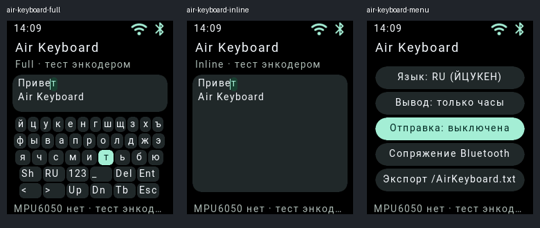

# Air Keyboard — состояние реализации

[Исходная концепция пользователя](SPEC.md) сохранена отдельно, без изменения
оригинального файла. Реализован первый программный этап для проверки UX без IMU.

Работают полная RU/EN-раскладка и символы, Inline-предпросмотр у каретки,
Unicode-редактор с лимитом 1024 байта, стрелки/удаление/Enter/Tab,
экспорт подтверждённого текста и сохранение вида/языка. Наведение и подтверждение
разделены: повторные down-сигналы без release не дублируют ввод.

Приложение добавлено в нативный каталог, Rhai-каталог, manifest и оба вида меню.
ID 32 — идентификатор приложения, а не новый экран старого пятибитного ABI.
В меню теперь 22 приложения; остальные стабильные ID не переназначались.

BLE использует имеющийся защищённый клавиатурный транспорт. Отправка требует
отдельного включения; обрыв связи очищает очередь приложения и выключает отправку.
Проверки передачи на реальных Android/Linux/Windows пока не выполнены.

**Не реализованы:** чтение MPU6050, регистрация/анализ IMU-трасс, распознавание
толчка и возврата, качество/пауза трекинга, гироскопическое наведение,
пространственные координаты, IMU-калибровка и мышь. Датчик пользователь пока
не установил. Энкодер используется только как явно обозначенный тестовый источник.
Это не готовая v1 по критериям исходного документа.

Код и управление: [README приложения](../../App/system/app/AirKeyboard/README.md).
Аппаратные выводы 14/15/16 остаются планом подключения и не инициализируются
новой прошивкой.
