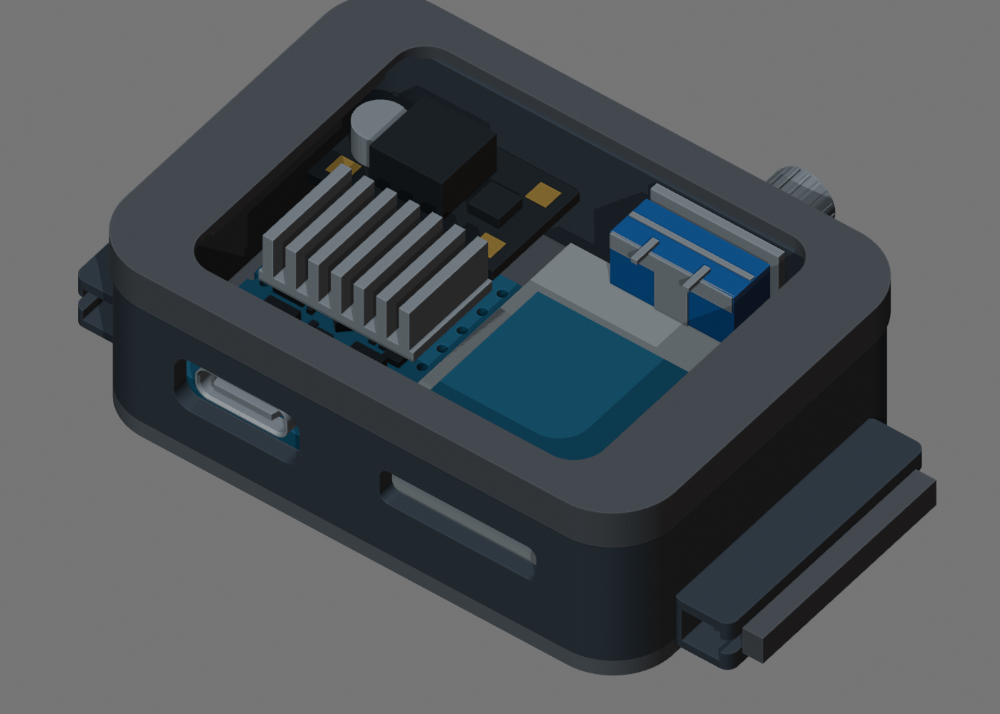

# Перепроверка пользовательской сборки

Текущий результат: [esp32s3_watch_box_reviewed.blend](../../esp32s3_watch_box_reviewed.blend).
**Полную сборку пока нельзя считать готовой к печати.** Это исправленная
проверочная раскладка с видимыми конфликтами, а не подтверждённая посадка всех деталей.

Исходный корпус, вырезы, крышки и шаблон отверстий сохранены: сравниваются
координаты вершин, грани, мировые матрицы и ссылки Boolean-модификаторов.
Пользовательские файлы `components.blend` и `fit_check.blend` не перезаписаны.
Удалённая пользователем чёрная ручка не восстановлена. Для удобного первого
просмотра скрыты экран, крышки, шаблон и инструменты вырезов; их геометрия
осталась в файле. Включить их можно через Outliner. Это режим осмотра внутренностей,
а не изменение конструкции.



## Что проверено по каждой детали

| Компонент | Исправление и основа | Ограничение |
|---|---|---|
| ESP32-S3-Zero | Официальная сетка Waveshare v2 без масштабирования. USB центрируется по **реальному** вырезу X≈−11,439, Z≈6,624 мм; раньше ошибочно использовался X=−5 | Ревизия платы и кабельный штекер не проверены. Утопление торца USB на 0,65 мм — вариант для примерки |
| Радиатор | 15×10×5 мм; следует за настоящим чипом в STEP, условная прокладка 0,2 мм | Форма рёбер условная; пайка/провода не смоделированы |
| SD | Плата 20×18 мм развёрнута компонентами вниз. Декоративная чёрная поверхность больше не выходит за номинальный контур и не считается твёрдой деталью | Высота/точная ревизия слота неизвестны. Есть пересечение с батареей |
| Запас карты | Условная зона 20+15 мм привязана к SD: теперь перемещается и вращается вместе с ним | Это запас из размеров пользователя, не точная модель вставленной карты |
| Батарея | Полные 28×27×5,7 мм, поворот на 90° в плоскости. Лента теперь внутри толщины 5,7 мм, а не добавляет 0,2 мм сверху | В данном положении пересекает SD, энкодер и скругление стенки; уменьшать её ради красивой картинки нельзя |
| Энкодер | Сохранена голая синяя деталь без breakout PCB и без удалённой ручки. Металлическая передняя часть утоплена внутрь; шайба и гайка остаются снаружи | 15×17 мм — данные пользователя; третья величина 12,4 мм, втулка, вал и изгибы выводов условные. Модель пересекает обе крышки и батарею |
| TPS61023 | 18×11×5 мм, перенесён над левой частью ESP; размеры не уменьшены | В проверяемой геометрии нет подтверждённых пересечений. Мелкие детали условные, монтажный запас не подтверждён |
| Дисплей | Сохранён кандидат LCDWIKI MSP1691 48×31 мм. Сплошная задняя зона SMD теперь считается только запасом | Совпадение ревизии не подтверждено. Его прежнее положение пересекает переднюю крышку; форму корпуса для устранения этого конфликта не меняли |
| MCP73871 | Оставлен отдельно в `UNPLACED` | У заказанной платы нет подтверждённых размеров. Старая красная заглушка не доказывает, что модуль помещается; конденсатор тоже не измерен |
| TP4056 | Скрытая альтернативная деталь | Не включается одновременно с выбранным MCP в проверяемую сборку |

## Результат проверки

[reviewed-fit.json](reviewed-fit.json) содержит границы каждого компонента,
положение, исходный SHA-256, контрольные суммы защищённых объектов и пары деталей.
Сначала ищутся кандидаты по сеткам/BVH, затем вычисляется Boolean INTERSECT.
Закрытый положительный объём подтверждает пересечение **этих моделей**; открытая
сетка считается неопределённым результатом. Кандидаты с нулевым объёмом не выдаются
за подтверждённый конфликт. Проверяются тело корпуса **и обе крышки**.

Остались два конфликта между группами компонентов: SD–батарея и энкодер–батарея.
Дополнительно: батарея–стенка, дисплей–передняя крышка,
энкодер–передняя/задняя крышки. Ошибочных пересечений MCP–радиатор в сборке нет:
неизмеренный MCP вообще не считается установленным.

Это не доказательство невозможности любой иной раскладки. Для решения о печати
нужны фактическая высота энкодера и SD, размеры MCP с выступающими деталями,
согласование крышки с экраном и место под пайку/изоляцию. Ранее подготовленные
[малые STL для примерки](print_checks/README.md) проверяют только отдельные посадки.

Повторить проверку пользовательского файла с сохранением отдельного результата:

```sh
blender -b --disable-autoexec --python-exit-code 1 \
  esp32s3_watch_box_fit_check.blend --python doc/enclosure/review_components.py
```

Скрипт [review_components.py](review_components.py) не перестраивает исходные
компоненты и не возвращает удалённую ручку. Старый `build_fit_check.py` — генератор
предыдущего варианта, а не команда обновления пользовательской сборки.
