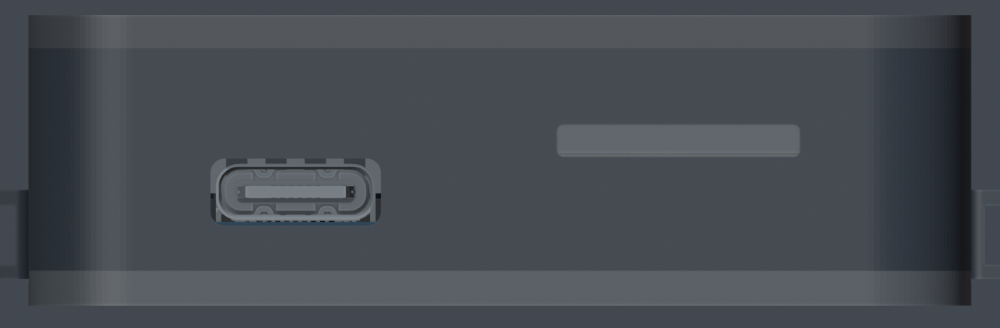
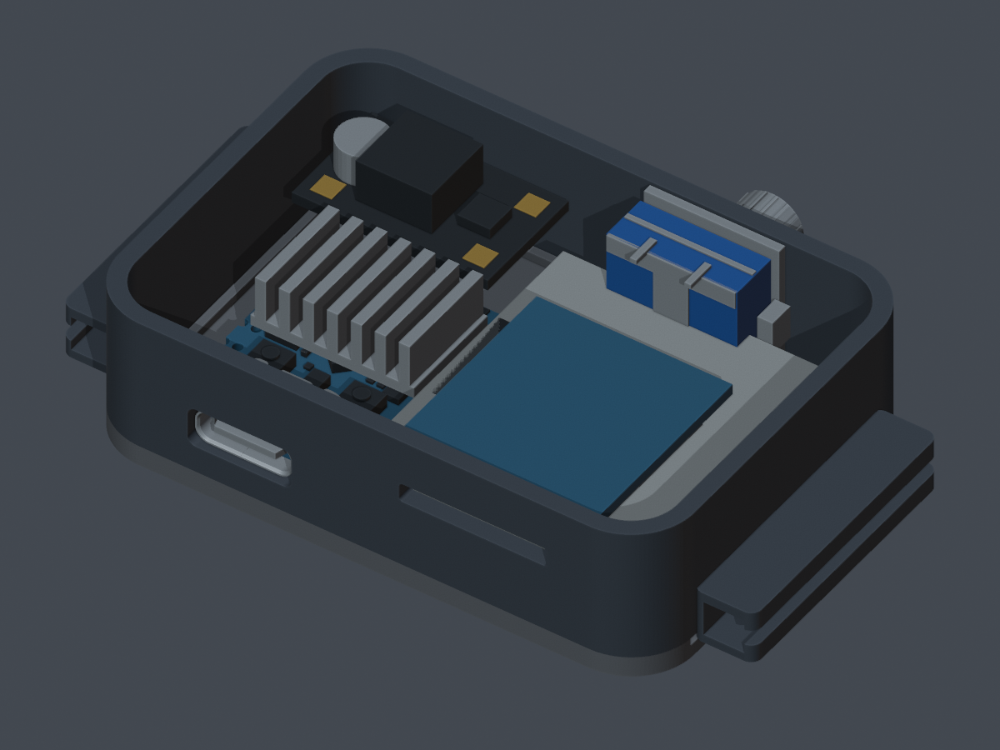

# Подогнанные отверстия и опущенная ESP · 5 ноября 2026

[Новая сборка Blender](../../../esp32s3_watch_box_ports_fitted.blend) создана
из текущего пользовательского `esp32s3_watch_box_reviewed.blend`. Исходный файл
сохранён без изменений; его SHA-256 записан в [dimensions.json](dimensions.json).



| Вырез | Было, мм | Стало, мм | Основание |
|---|---:|---:|---|
| USB-C | 12,2×5,4 | **9,54×3,76** | Передняя часть текущей CAD-модели 8,94×3,16 + 0,3 с каждой стороны |
| SD | 15,2×3,5 | **13,6×1,8** | Смоделированная щель 13×1,2 + 0,3 с каждой стороны; реальные размеры не подтверждены |
| Энкодер | Ø8,4 | **Ø7,8** | Номинальный внешний контур резьбы модели Ø7,2 + 0,3 радиального зазора; размер остаётся справочным |

USB-окно центрировано по передней части разъёма, а не его задним лапкам.
Щель SD поднята на 0,2 мм к центру смоделированного входа; центр энкодера
поднят на 0,25 мм к втулке. Наружные габариты и базовая сетка корпуса сохранены.

ESP, её USB-разъём и радиатор опущены вместе на **2,655 мм**. Низ PCB теперь
на Z=1,15 мм: верх буртика задней крышки под краем платы Z=0,85 плюс 0,30 мм
под изоляцию. Плоское дно крышки находится на Z=0. Опускать до 0,30 мм над
плоским дном нельзя без изменения буртика или положения платы: край войдёт
в крышку. Новые столбики не добавлены. Предусмотреть изоляцию и крепление платы
при реальной сборке; зазор сам по себе её не закрепляет.



На втором рендере экран и передняя крышка скрыты только для осмотра. В Blender
они сохранены, геометрия и положение крышек не менялись. Прочие компоненты
сохранены в пользовательских положениях. Старые красные предупреждения скрыты,
поскольку они относятся к прежним позициям; это не означает устранение всех
ранее найденных конфликтов.

## STL для печати и примерки

Координаты STL — **миллиметры, печатать в масштабе 100%**. Детали отдельно
перенесены на Z=0; для положения в сборке использовать Blender-файл.

| Файл | Габариты, мм |
|---|---:|
| [case.stl](case.stl) — тело корпуса с новыми вырезами | 63,7×36,8×12,95, включая крепления ремешка |
| [front-cover.stl](front-cover.stl) — сохранённая передняя крышка | 52,8×36,8×2,7 |
| [rear-cover.stl](rear-cover.stl) — сохранённая задняя крышка | 52,8×36,8×2,8 |
| [usb-sd-coupon.stl](usb-sd-coupon.stl) — малая стенка для примерки | 43×12,5×1,699 |

Тело высотой 12,95 мм не равно высоте всей закрытой сборки: с текущими крышками
диапазон Z составляет −1,95…14,35 мм, то есть **16,3 мм**. Общую высоту здесь
не уменьшали.

Сначала напечатать малую стенку: проверить USB-штекер с его пластиковой частью,
вставление и извлечение карты. 0,3 мм — выбранный монтажный запас, не калибровка
конкретного принтера. SD/энкодер остаются справочными моделями; плата MCP73871
по-прежнему не имеет подтверждённых размеров. Ранее отмеченные конфликты батареи,
дисплея и энкодера этим изменением не исправлены. Подгонка отверстий не является
подтверждением готовности всей сборки к окончательной печати.

## Проверка

Повторным открытием файлов сверены исходный SHA, сетки и локальные трансформации
всех деталей: изменены только три выреза и высота групп ESP/радиатора. Boolean
INTERSECT не обнаружил объёма пересечения USB со стенкой, PCB с задней крышкой
и втулки энкодера со стенкой. Все четыре STL замкнуты, с положительным объёмом;
габариты после чтения бинарных STL совпали с манифестом в пределах 0,001 мм.
Это проверка цифровых моделей, не точности физических деталей или печати.

```sh
blender -b --disable-autoexec --python-exit-code 1 esp32s3_watch_box_reviewed.blend --python doc/enclosure/fit_ports.py
blender -b --disable-autoexec --python-exit-code 1 esp32s3_watch_box_ports_fitted.blend --python doc/enclosure/verify_ports.py
```

Генератор использует текущую локальную правку исходника. Проверяющий скрипт
откажется сравнивать другой вариант этого файла с сохранённым SHA.
[Скрипт подгонки](../fit_ports.py) · [Проверка](../verify_ports.py) ·
[Рендеры](../render_ports.py).
