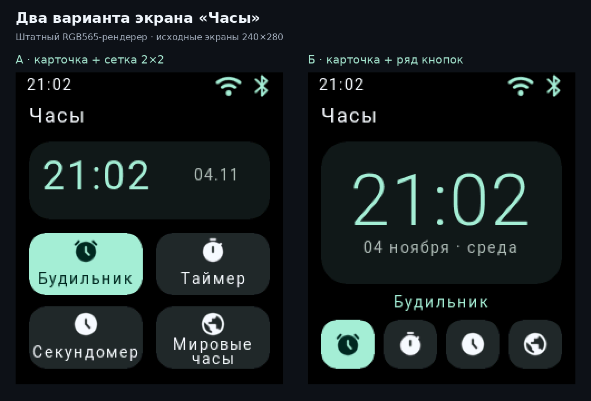

# Варианты компоновки «Часов»

- **А:** карточка времени и четыре плитки 2×2. Все подписи видны сразу.
- **Б:** большая карточка времени и ряд четырёх кнопок. Подпись выбранного
  действия расположена над рядом; на остальных кнопках остаются иконки.

Это программные макеты, построенные штатным RGB565-рендерером на синтетических
данных (21:02, 4 ноября). Исходные PNG: [А](clock-grid.png), [Б](clock-dock.png),
240×280 каждый. На сравнении они увеличены ровно вдвое методом nearest-neighbor.

Действующий экран прошивки и подключённые часы не менялись. Макеты доступны
только host-сборке: `Firmware/src/material/clock_layout_preview.rs` и сценарии
`clock-layout-grid` / `clock-layout-dock` в `Firmware/tools/render_watch.rs`.
Большие цифры используют штатный атлас часов; кнопки — штатные значки и шрифты.
После выбора варианта его можно перенести в рабочий экран и проверить навигацию.
