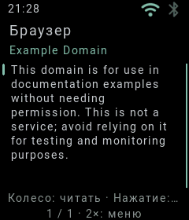
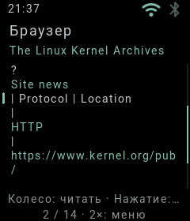
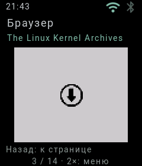

# Браузер без Gateway · ESP32-S3 · 5 ноября 2026

Это снимок реального RGB565-буфера подключённых часов, 240×280.
`example.org` открыт по Wi-Fi: DNS, проверка TLS-сертификата и HTML-разбор
выполнены прошивкой ESP32-S3. GoogleAuthGateway для этого запроса не используется.
Приложения Google продолжают использовать прежний Gateway.

На окончательной сборке дополнительно открыт `www.kernel.org`: большая
страница разбита на 14 частей, переход между частями идёт из RAM.

На этой сети прямой запрос DuckDuckGo вернул требование проверки.
Браузер сообщает об отказе; успешная выдача поиска этим прогоном не подтверждена.
PNG-иконка Download с `kernel.org` загружена, декодирована и уменьшена на часах.
Прозрачность наложена на светлый фон; возврат из превью сохраняет страницу.

148 host-тестов прошли, включая JPEG/PNG и локальный HTTPS-стенд с проверкой
CA/имени и отсутствия Gateway credentials в публичных запросах. Дополнительно
прошли 5 provider-тестов и 4 теста пакетов. Это не проверка произвольных сайтов.
В логе окончательного аппаратного прогона: одна загрузка, ноль panic и ошибок
TLS handshake. После закрытия браузера heap_free=1 246 616 байт,
internal_free=54 712; это один снимок, не длительный тест на утечки.
Часы оставлены на циферблате, USB block server продолжает работать.

Часы загружены через USB PC block server: он обслуживает системный диск,
но не получает и не преобразует сайты за часы. Отключение ПК в этом режиме
прервёт доступ к системному образу. Для самостоятельной загрузки нужна microSD.

Подробности управления, форматов и пределов памяти —
[README браузера](../../../App/system/app/Browser/README.md).
