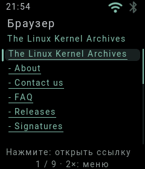
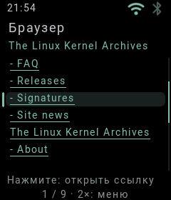
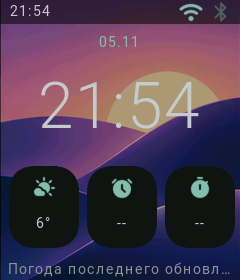

# Читаемый HTML и обновление погоды · 5 ноября 2026

Снимки реального RGB565-буфера ESP32-S3, 240×280. Установлены App `bfa99a9`
и Firmware `ad30ba42`. HTML получен часами с `www.kernel.org` по HTTPS.

Маркеры теперь находятся рядом с пунктом. Ссылки подчёркнуты и выделяются фоном;
нижняя подсказка объясняет нажатие. Разрывов предложения возле каждого `<a>`
больше нет. На этой странице вместо 14 частей получилось 9; результат зависит
от содержимого сайта. Проверено открытие и прокрутка; это режим чтения без JS.

Погодный циферблат получил показание без ручного обновления. Выбранный погодный
циферблат запрашивает данные раз в 30 секунд при наличии сети и разблокированных
часах. Без него запросов нет; текущий запрос и поиск города защищены от замены.
30-секундная граница, отсутствие сети/виджета и повторы ошибок проверены host-тестом.

Всего прошло 152 host-теста и 4 теста пакетов; release и образ GPT/AVB проверены.
В аппаратном прогоне одна загрузка и ноль panic. После закрытия браузера:
heap_free=1 245 352, internal_free=54 712 байт; это один снимок, не проверка утечек.
Часы оставлены на циферблате. USB PC block server продолжает подавать системный
диск и не обрабатывает сайты за часы. Пользовательские данные образа сохранены.
